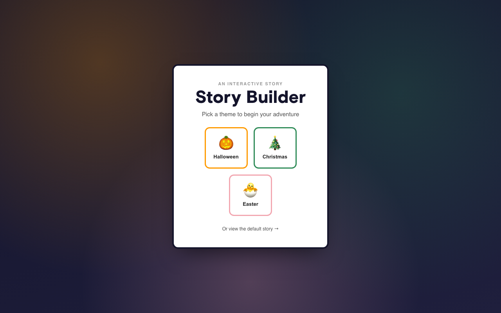
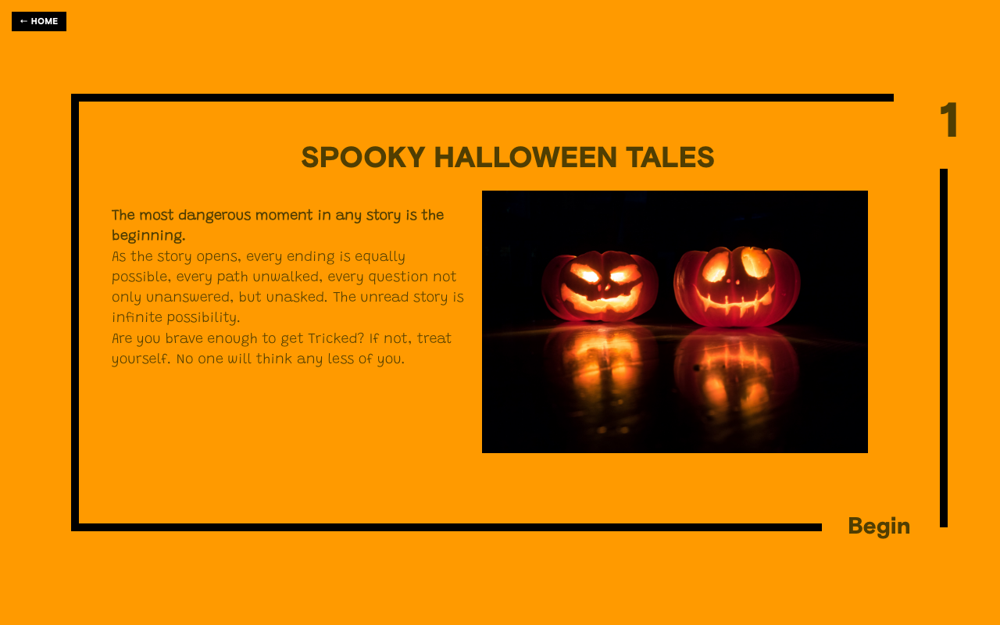

# Story Builder

[](https://github.com/sybilla11/story-builder/actions/workflows/ci.yml)

A React + TypeScript app that renders an interactive, frame-by-frame story from JSON data. Pick a theme (Halloween, Christmas, Easter) or load the default story, then step through it one full-screen frame at a time. Originally built with Create React App; since migrated to a modern Vite/TypeScript/Vitest toolchain.

Live site: https://sybilla11.github.io/story-builder/

| Theme picker | Story frame |
|---|---|
|  |  |

## How it works

The app consists of a set of frames that the user navigates through via buttons. Only one frame is visible at a time, and the frame always fills the entire viewport. If a frame's content is taller than the viewport, the frame grows past the fold and the page scrolls; if it's shorter, the frame is exactly as tall as the viewport.

Each frame follows a common template. The frames and their contents come from a `Story` (`{ frames: Frame[] }`, see `src/types/story.ts`), sourced one of two ways:

- **`/story`** — fetches `public/data/story.json` via AJAX on initialization.
- **`/story/:theme`** — loads a bundled theme (`halloween`, `christmas`, `easter`) from `src/component/directory/themes/`, no network request needed.

The homepage (`/`) lets the user pick a theme, or follow a link straight to the default `/story`.

## Tech stack

- **React 19** with function components and hooks
- **TypeScript**
- **Vite** for the dev server and production build
- **react-router** for client-side routing (`HashRouter`)
- **Sass** (CSS modules) for component styling
- **DOMPurify** to sanitize story HTML before rendering
- **Vitest** + **React Testing Library** for tests
- **GitHub Actions** for CI (test and build on every push/PR)
- Deployed to **GitHub Pages** via the `gh-pages` package

## Getting started

```bash
npm install
npm run dev
```

This starts the Vite dev server, by default at `http://localhost:5173/story-builder/`.

## Available scripts

| Script | Description |
|---|---|
| `npm run dev` | Run the dev server (Vite) |
| `npm run build` | Type-check with `tsc` and build for production into `dist/` |
| `npm run preview` | Preview the production build locally |
| `npm test` | Run the test suite once (Vitest) |
| `npm run deploy` | Build and publish `dist/` to the `gh-pages` branch |

## Project structure

```
src/
  App.tsx                       # routes: /, /story, /story/:theme
  pages/homepage/               # theme picker
  container/StoryBuilder.tsx    # loads a story and steps through its frames
  component/
    Viewport/                   # full-viewport frame wrapper
    directory/                  # theme list + bundled theme data
  hooks/useStory.ts             # fetches or resolves the story for a route
  types/story.ts                # shared Story / Frame types
public/data/story.json          # default story served at /story
```

Tests are colocated as `.test.tsx` / `.test.ts` files.

## Deployment

The site is hosted on GitHub Pages, served from the `gh-pages` branch. `npm run deploy` builds the app and pushes the `dist/` output to that branch via the `gh-pages` package. The `base` path in `vite.config.ts` (`/story-builder/`) matches the GitHub Pages project-site path, and the app uses `HashRouter` so deep links and refreshes don't 404 on Pages.

## CI

Every push and pull request to `main` runs tests and a production build via `.github/workflows/ci.yml`.
